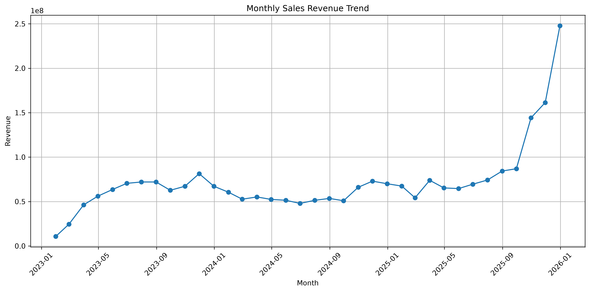
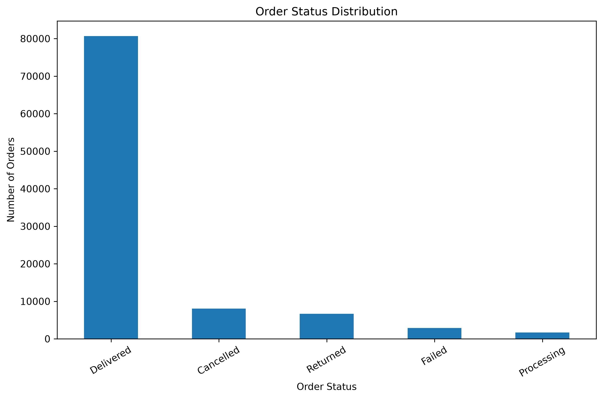
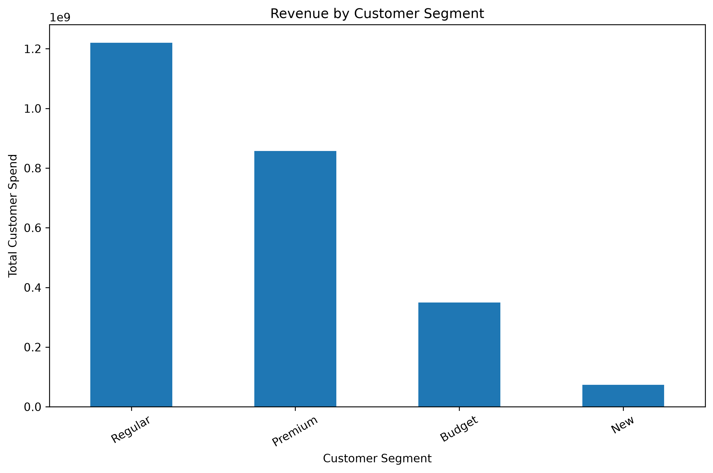
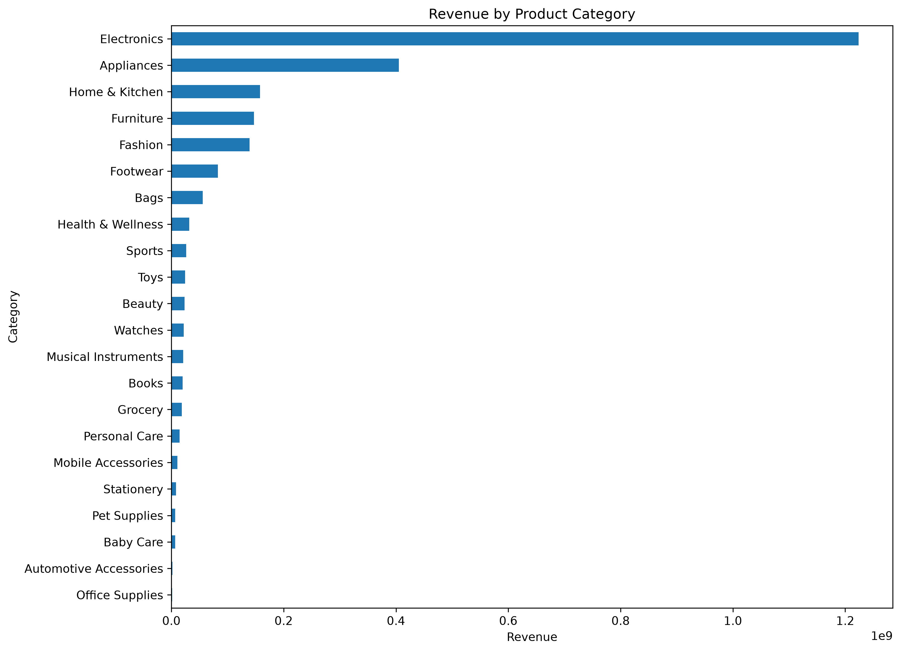
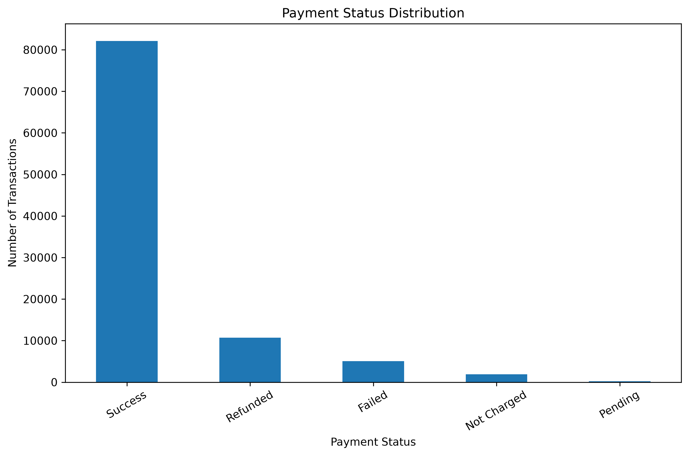
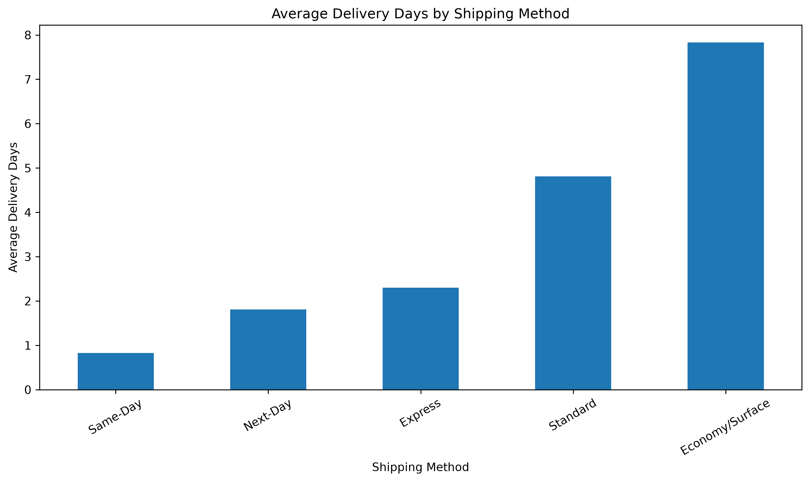
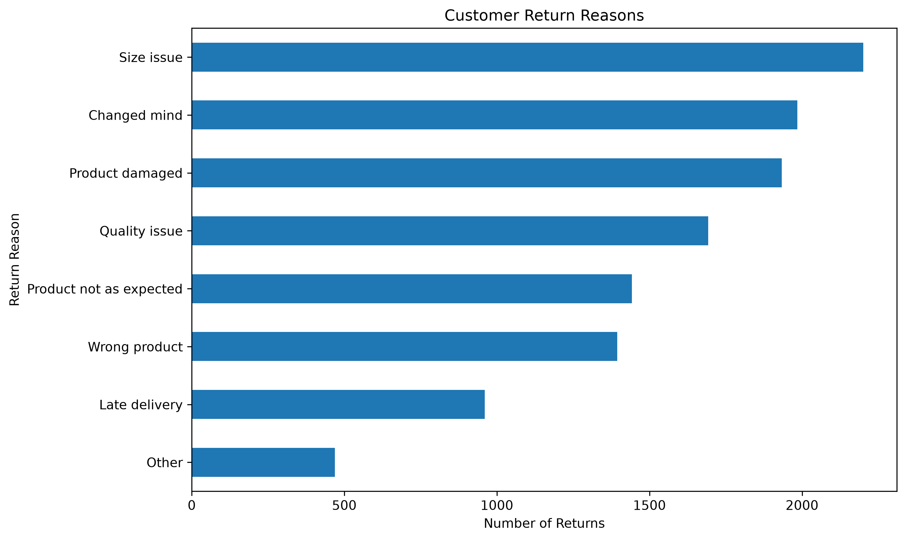
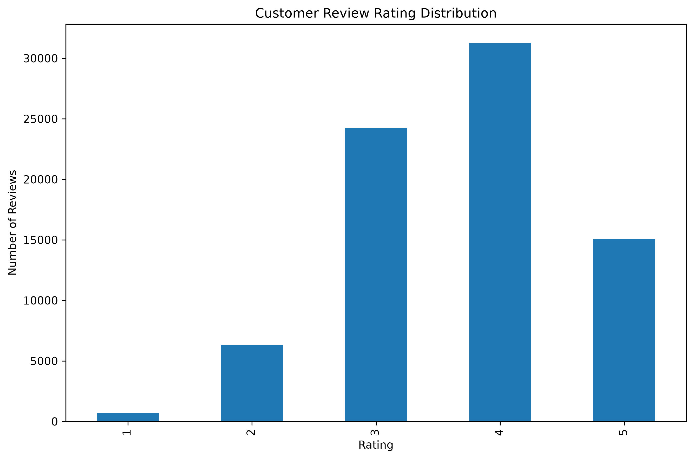
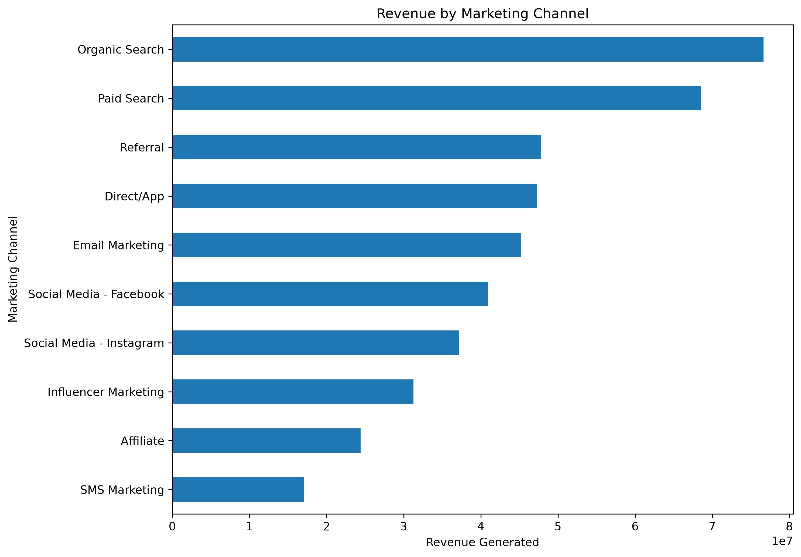
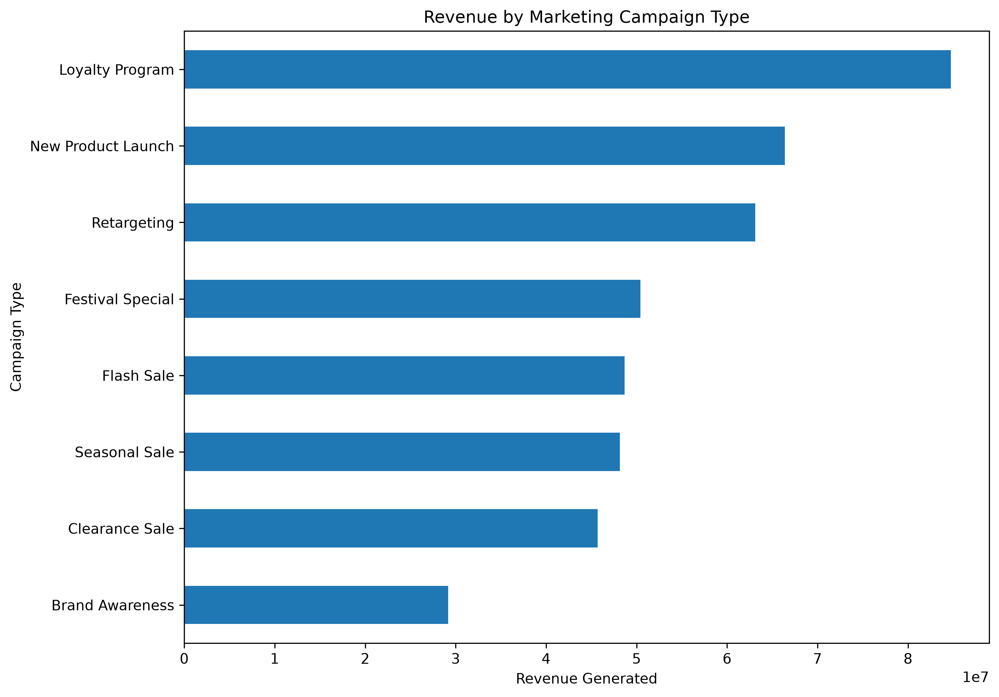

# India Commerce Intelligence
## Exploratory Data Analysis Report

**Project:** India Commerce Intelligence
**Analysis period:** 2023–2025
**Datasets analysed:** 9

---

## 1. Project Overview

This project analyses e-commerce data to understand sales performance, customer behaviour, product performance, payment trends, delivery operations, returns, customer satisfaction and marketing effectiveness.

## 2. Dataset Overview

- Total datasets: 9
- Total records: 659,318

| Dataset | Records | Columns | Missing Values |
|---|---:|---:|---:|
| Customers | 25,000 | 18 | 2,300 |
| Products | 550 | 14 | 0 |
| Orders | 100,000 | 16 | 116,532 |
| Shipments | 89,681 | 11 | 4,642 |
| Customer Reviews | 77,530 | 8 | 0 |
| Payments | 100,000 | 8 | 0 |
| Order Items | 254,331 | 9 | 0 |
| Marketing Campaigns | 151 | 14 | 0 |
| Returns | 12,075 | 8 | 0 |

## 3. Sales Performance Analysis

- Total orders: 100,000
- Total order value: 2,572,592,368.57
- Average order value: 25,725.92
- Delivered orders: 80,679
- Delivered order value: 2,084,309,803.30

### Order Status Distribution

| order_status   |   Orders |
|:---------------|---------:|
| Delivered      |    80679 |
| Cancelled      |     8073 |
| Returned       |     6681 |
| Failed         |     2880 |
| Processing     |     1687 |

### Monthly Sales Trend

December 2025 recorded the highest monthly order value in the analysed period.

## 4. Customer Analysis

- Total customers: 25,000
- Average customer spend: 100,031.11
- Average orders per customer: 3.88
- Churned customers: 13,365

### Customer Segment Distribution

| customer_segment   |   customers |   average_spend |   total_spend |
|:-------------------|------------:|----------------:|--------------:|
| Budget             |        7713 |         45355.2 |   3.49825e+08 |
| New                |        3294 |         22451.5 |   7.39553e+07 |
| Premium            |        2991 |        286623   |   8.57288e+08 |
| Regular            |       11002 |        110862   |   1.21971e+09 |

## 5. Product Performance Analysis

- Total products: 550
- Product categories: 22
- Unique brands: 148
- Average product rating: 4.01

### Category Revenue

| category               |     Revenue |
|:-----------------------|------------:|
| Electronics            | 1.22362e+09 |
| Appliances             | 4.05233e+08 |
| Home & Kitchen         | 1.58076e+08 |
| Furniture              | 1.47011e+08 |
| Fashion                | 1.39394e+08 |
| Footwear               | 8.26035e+07 |
| Bags                   | 5.59121e+07 |
| Health & Wellness      | 3.18243e+07 |
| Sports                 | 2.65241e+07 |
| Toys                   | 2.43413e+07 |
| Beauty                 | 2.33654e+07 |
| Watches                | 2.20064e+07 |
| Musical Instruments    | 2.09593e+07 |
| Books                  | 2.00369e+07 |
| Grocery                | 1.84779e+07 |
| Personal Care          | 1.45504e+07 |
| Mobile Accessories     | 1.07317e+07 |
| Stationery             | 8.05786e+06 |
| Pet Supplies           | 6.97205e+06 |
| Baby Care              | 6.81113e+06 |
| Automotive Accessories | 1.77934e+06 |
| Office Supplies        | 1.61262e+06 |

### Top 10 Brands by Revenue

| brand        |     Revenue |
|:-------------|------------:|
| Chaudhry     | 5.2133e+08  |
| Mistry       | 1.13703e+08 |
| Boase        | 1.00408e+08 |
| Gandhi-Lanka | 8.44858e+07 |
| Gola         | 7.68971e+07 |
| Kala-Vaidya  | 7.62958e+07 |
| Choudhury    | 7.614e+07   |
| Handa        | 6.71901e+07 |
| Behl-Chanda  | 6.4634e+07  |
| Shanker-Dhar | 5.76924e+07 |

## 6. Payment, Shipment and Returns Analysis

### Payments

- Total transactions: 100,000
- Total amount paid: 2,391,049,619.92
- Transaction fees: 7,965,496.29
- Refund amount: 268,740,811.64

| payment_status   |   Transactions |
|:-----------------|---------------:|
| Success          |          82137 |
| Refunded         |          10690 |
| Failed           |           5068 |
| Not Charged      |           1876 |
| Pending          |            229 |

### Shipments

- Total shipments: 89,681
- Average delivery days: 4.10

| shipping_method   |   Average Delivery Days |
|:------------------|------------------------:|
| Economy/Surface   |                    7.83 |
| Express           |                    2.3  |
| Next-Day          |                    1.81 |
| Same-Day          |                    0.83 |
| Standard          |                    4.81 |

### Returns

- Total returns: 12,075
- Total return refunds: 105,898,381.80

| return_reason           |   Returns |
|:------------------------|----------:|
| Size issue              |      2201 |
| Changed mind            |      1984 |
| Product damaged         |      1933 |
| Quality issue           |      1692 |
| Product not as expected |      1442 |
| Wrong product           |      1394 |
| Late delivery           |       960 |
| Other                   |       469 |

## 7. Customer Reviews Analysis

- Total reviews: 77,530
- Average rating: 3.69 / 5

| review_sentiment   |   Reviews |
|:-------------------|----------:|
| Positive           |     46168 |
| Neutral            |     24132 |
| Negative           |      6997 |
| Unknown            |       233 |

## 8. Marketing Campaign Analysis

- Total campaigns: 151
- Campaign cost: 187,120,911.26
- Revenue generated: 436,296,290.91
- Total conversions: 17,179
- Total impressions: 9,217,314
- Total clicks: 294,369

- Overall CTR: 3.19%

### Marketing Channel Revenue

| channel                  |     Revenue |
|:-------------------------|------------:|
| Organic Search           | 7.66574e+07 |
| Paid Search              | 6.85796e+07 |
| Referral                 | 4.77884e+07 |
| Direct/App               | 4.72377e+07 |
| Email Marketing          | 4.51834e+07 |
| Social Media - Facebook  | 4.09039e+07 |
| Social Media - Instagram | 3.71696e+07 |
| Influencer Marketing     | 3.12494e+07 |
| Affiliate                | 2.4419e+07  |
| SMS Marketing            | 1.71079e+07 |

### Campaign Type Revenue

| campaign_type      |     Revenue |
|:-------------------|------------:|
| Loyalty Program    | 8.47336e+07 |
| New Product Launch | 6.63706e+07 |
| Retargeting        | 6.31053e+07 |
| Festival Special   | 5.04041e+07 |
| Flash Sale         | 4.86818e+07 |
| Seasonal Sale      | 4.8151e+07  |
| Clearance Sale     | 4.56895e+07 |
| Brand Awareness    | 2.91604e+07 |

## 9. Key Business Insights

1. December 2025 recorded the highest monthly order value.
2. Regular customers form the largest customer segment.
3. Electronics generates the highest category revenue.
4. Successful payments account for 82.14% of transactions.
5. Same-Day shipping has the shortest average delivery time.
6. Size issues are the most frequent return reason.
7. The average customer review rating is 3.69 out of 5.
8. Organic Search generates the highest marketing channel revenue.
9. Loyalty Programs generate the highest revenue among campaign types.

## 10. Recommendations

- Investigate customer churn and develop retention strategies.
- Review the performance and inventory of high-revenue products.
- Investigate the leading reasons for product returns.
- Monitor delivery delays across shipping methods.
- Improve customer experience to increase review ratings.
- Evaluate marketing campaigns using both revenue and campaign cost.

## 11. Conclusion

The exploratory analysis provides an overview of e-commerce sales, customers, products, payments, logistics, returns, customer feedback and marketing performance. These findings establish a foundation for further business intelligence and dashboard development.

---
*Generated automatically using Python and Pandas.*